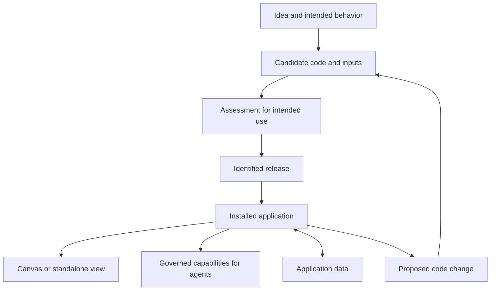

CanvasOS should turn a useful idea into dependable behavior, then support its operation and improvement. The goal is an application people and agents can use, with understandable limits and an owned path for repair. A convincing preview is one step toward that result.

The direction includes internal builders, supported code intake and managed application updates. The construction and operating flow described here is proposed architecture. It does not establish that an application, host or deployment path has passed its checks.

## An application outlives its screen

Consider a tool that compares 100 expected units with 80 recorded units. Its components might include a record table, evidence viewer and comparison controls. The application owns the comparison's meaning and relevant working data. Its actions might retrieve records or submit an authorized correction through the responsible system.

The interface should show which records an action affects. A table selection, calculation and correction can be related without becoming one indivisible component. This separation supports reuse, focused debugging and isolation when something fails.

The underlying application can serve several hosts:

- **Canvas:** compose views beside other tools and shared work.
- **Standalone web view:** provide a focused route into the application.
- **Studio:** author, inspect and refine application behavior.

A host is where an interface runs. It does not automatically own the application's records or grant its permissions. Two views can serve one operating application. Removing a view need not delete its data or end the review. Agents can also use governed capabilities without a visible interface.

## Connect the tool to the work

A generated comparison needs to know which delivery it concerns, which records it can read and what each control is allowed to do. Those relationships should remain understandable after the original conversation ends. Their exact representation is still a design choice.

For the delivery review, the builder connects the view to the intended delivery and available source records, checks current access, and exposes only supported actions. A missing ledger connection stays visible as missing information. Placing the view in a workspace then makes the tool available for the team to use and refine.

The view also needs to explain the age of its information:

- **Live:** read the source when the information is needed.
- **Cached:** reuse a previously retrieved result, with an understood refresh behavior.
- **Materialized:** retain a prepared snapshot until it is regenerated.

One workspace can combine these forms. A saved comparison might preserve yesterday's figures beside a live delivery status. Source and freshness should be visible where that difference affects the decision. Saving a workspace layout does not automatically freeze the external records it displays.

## Keep implementation and operation distinct

The diagram separates a proposed implementation from an operating application. Data changes during use; code changes return through assessment and release. Views provide access to the same application rather than creating a separate copy of its work.

A **candidate** is the particular code and relevant inputs being considered. A **release** identifies an implementation and the evidence supporting its intended use. An **installed instance** is that application operating in a particular customer installation. It retains its identity through supported updates.

These distinctions need not become separate services. They prevent evidence about yesterday's code from silently qualifying today's edit. Specifications, examples and templates guide construction, but code determines actual behavior. A correct specification cannot prove that an implementation follows it.

## Build around the intended job

Studio should help an author move through assumptions, consequential questions, construction, review and refinement. A supplied brief can start this work without a continuous event feed. Internal builders come first; supported MCP and command-line tooling can submit external material for assessment. Submission does not make code executable or published.

Useful checks follow the intended behavior. For the comparison tool, that includes source meanings, calculations and relevant interactions. A clean build establishes less than a correct comparison. Synthetic records can support a preview, but cannot establish that a real connection works or that an unconnected source contains needed information.

Repository access, editing, building, previewing, reading data, publishing and changing external records are different permissions. Each action uses its applicable authority. Passing an assessment does not grant publication rights, and publishing a view does not authorize corrections in another system. [Systems and agents](/architecture/systems-and-agents) explains those operating relationships.

## Operate and change deliberately

An ordinary data update is not a new application release. Changing calculation code or view behavior is a versioned upgrade. Updates should account for current data, customer customization and work already underway. Publication and successful placement in a host are also distinct: a placement failure should not cause duplicate application creation.

If the comparison calculation fails, block that component and actions materially dependent on it. An independent evidence viewer can remain available if its behavior is sound. A polished screen must not make the failed calculation appear usable.

Repair produces a changed candidate and relevant reassessment. The application should report what operates, what remains unavailable and who owns the next step. Exact packaging and deployment mechanisms remain open; [Operating and evolving](/architecture/operating-and-evolving) covers the wider maintenance responsibility.
