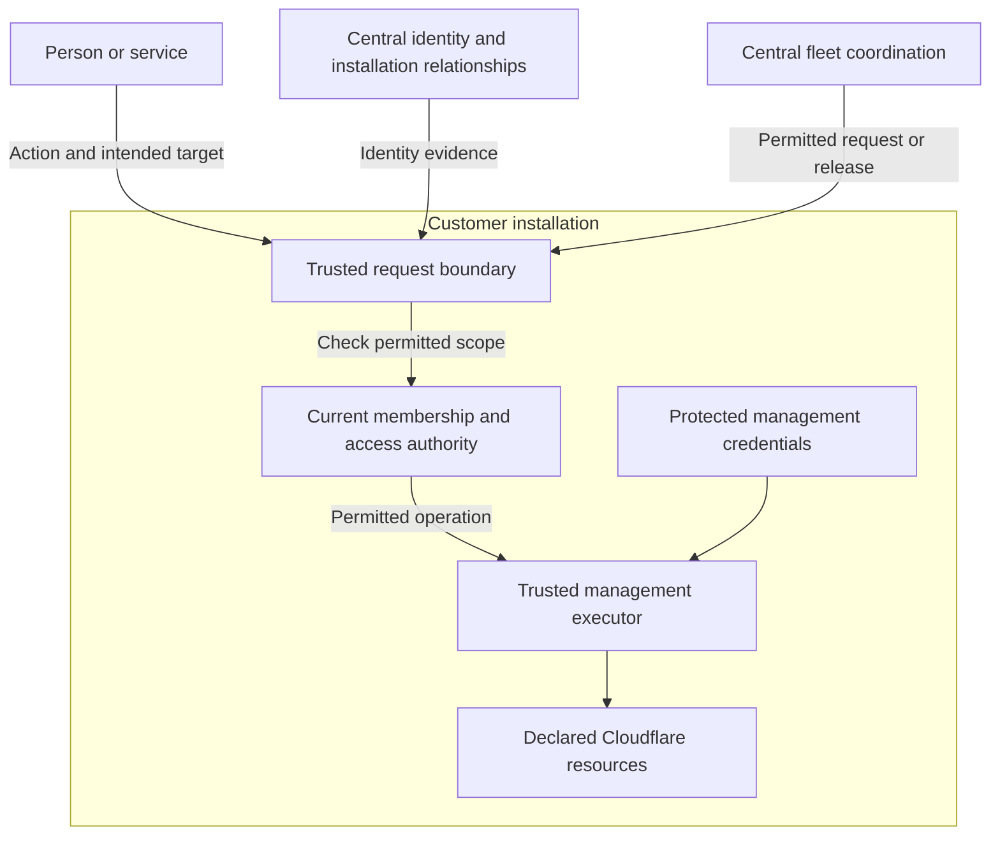

The core gives CanvasOS a consistent answer to five questions: who is acting, which organization is involved, which installation is targeted, what is permitted, and what actually changed. Applications, agents and interfaces should use these same meanings.

This is intended architecture. The responsibility split is settled; the concrete identity integration, storage and enforcement mechanisms still need design and proof.

## Identity and authority have different jobs

Central services establish identity and installation relationships. Authentication establishes the caller's identity. Customer-side authority owns current organization membership and access rules, and decides which operations the caller may perform.

The identity integration should map verified external identities to stable platform actors. For a human, that means preserving the trusted identity provider and stable account identifier rather than merging accounts because their displayed emails match. Services also need stable, attributable identities. A service acting under its own grant and one acting for a person have different authority relationships.

A successful login therefore provides evidence about identity. The customer's current rules determine action rights. Where a customer has several installations, the design needs one identified authority owner or controlled copies with defined freshness. Independent membership lists must not become competing answers to the same question.

Only the responsible trusted component changes authoritative records. Cached summaries can explain an earlier observation, but do not grant current permission. Related records can be saved together within their owner; saving that platform change does not prove a later provider action succeeded.

An organization is the context in which membership and authority apply. An installation is a deployment boundary. A Cloudflare account identifies infrastructure, and a paying account identifies a commercial relationship. Their relationships matter, but they are separate concepts.

The diagram follows an infrastructure request. The same separation between identity and authority applies to application actions. It shows responsibilities rather than required network calls or separate services.

## Management access stays with the customer

The default location for long-lived Cloudflare management credentials and their trusted executor is the customer's installation. Central fleet services can offer releases and send permitted management requests. They do not retain standing credential copies or unrestricted power to recreate equivalent access.

The executor must restrict the requested operation and target, even if its provider credential can do more. Keeping the secret local is only part of that boundary. The design must also control changes to the code that uses it.

Setup and exceptional recovery need explicit scope because the normal executor may not yet exist or may be unavailable. Those paths should establish or restore permitted administration without quietly creating permanent central access. [Recovery and platform changes](/architecture/recovery-and-platform-changes) explains initial authority, privileged updates and restoration. [Operating and evolving](/architecture/operating-and-evolving) covers continuing support.

## Permissions follow the work

Reading shared information, changing a source record, editing application code, activating a release and managing infrastructure are different abilities. A role may combine them, but one does not automatically imply another. Services and agents also need attributable identities and permitted scope. Their conversational role cannot supply that authority.

Applications keep ownership of their domain rules and data. The core supplies common identity and platform controls without turning every customer record into a platform record. A shared workspace may deliberately disclose information to its audience without requiring every viewer to have an account in every upstream system. Permission to change the source remains a separate concern.

## Example: applying an application update

A central fleet service offers a new release to a customer installation. The installation identifies the request, checks current permission and the intended target, and approves the supported change. The local executor uses protected management access to apply it.

The operation record can preserve who requested the change, the intended release and the observed result. If the provider response is lost, dispatch alone cannot establish success. Inspection or supported recovery must resolve what happened before repetition is assumed safe.

Continuing work needs a durable identity: another delivery of the same intent should find the supported existing work, while a changed target or effect cannot silently replace it. The design must state when delayed or resumed effects require another authority check. Removing future permission cannot reverse an effect already accepted by a provider. Inspection and recovery still use their applicable current authority; knowing an operation reference grants neither. A service may retain an independent grant when a human loses permission, but it cannot use that grant to preserve a revoked delegated human right.

## Choices still to make

The next design work must select identity-provider integration, authoritative storage, authenticated requests, credential mechanisms and supported recovery. Access changes also need explicit timing: when does a removed membership stop authorizing new work, and what happens to work already underway?

Customer-side placement does not establish complete offline operation. Supported behavior during identity, network or provider outages must follow the actual dependencies. These choices give the boundary practical meaning without changing its ownership.
