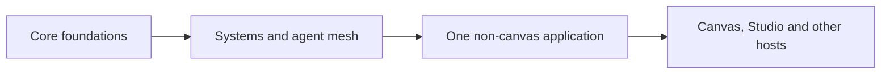

The architecture describes the shape of CanvasOS. Delivering it means joining those responsibilities into working journeys and checking them against real systems. A useful first proof is smaller than the whole vision, while keeping the important boundaries intact.

## The agreed sequence

Each stage should supply working capabilities that the next can use. Research and design can proceed in parallel; this sequence describes the operating evidence required before relying on later layers.

**Core foundations** establish identity, organizations, current access, installations and trusted management. A human and a service identity need to perform permitted work, encounter meaningful access boundaries and inspect supported failures.

**Systems and agent mesh** carry that identity and authority through connected capabilities. The platform needs to demonstrate actual results through both direct software calls and system-specific agents.

**A non-canvas application** joins the foundation and connected systems in a small working tool. Its creation, access, updates, state and observations should work without depending on Canvas or Studio. A minimal administrative interface can support earlier core work.

**Interface hosts** then provide richer ways to use those capabilities. Canvas supports composition and shared work; Studio supports authoring and refinement; focused pages serve particular tasks. Each should preserve the application's identity and useful work where supported.

Documentation and simulation support the sequence throughout. Simulation can expose failures and confusing situations, but real authentication, provider behavior and deployed access boundaries need their own evidence.

## Direction already settled

CanvasOS is an application-independent platform. The canvas is its expected primary human interface, while agents and other interfaces can use its capabilities too.

System-specific agents represent systems in the mesh. Direct governed software interfaces remain valid. External systems retain responsibility for executing their own operations.

Customer-side authority owns current membership and access decisions. Central services establish identity and installation relationships. Long-lived infrastructure-management credentials and their trusted executor belong in the customer installation by default; setup and exceptional recovery need explicit scope.

Generated interfaces should support information, insight, collaboration and authorized actions. Broader autonomous operation of customer business processes remains a future direction. Application behavior can vary without turning every choice into a platform rule.

Mintlify is selected for documentation. Existing product repositories remain references until a concrete reuse case is accepted.

## What remains open

| Question | Why it matters |
| --- | --- |
| Which identity integration fits human and service access? | It affects login, external-agent access, revocation and operating dependencies. |
| How should authoritative records and searchable summaries be stored? | Access decisions, restart recovery and convenient views have different consistency needs. |
| What exact account, environment and credential arrangement supports management? | Logical customer boundaries must correspond to actual permitted targets and provider behavior. |
| How should observations become a workspace plan? | Agents need usable context, ways to compare interventions and a clear handoff to construction. |
| Which construction and assessment tools should agents use? | Intent, generated behavior and the evidence of usefulness need to remain connected. |
| Which shared facilities should applications receive? | Application hosting is in scope; the breadth of common domain storage and background services remains open. |

The responsibility map does not prescribe a service for every box. Physical packaging, interfaces, storage products and agent orchestration remain engineering choices to resolve against representative work.

## A bounded next implementation proposal

The current planning closeout proposes a fresh independent core pilot: one organization, one installation, two separated logical environments, human and service access, durable operation records and a bounded management journey. A minimal interface would make the result inspectable.

Its source implementation and local integration are a proposed next scope, rather than an authorization supplied by this guide. Actual account actions, spending, customer deployment and repository adoption retain their own boundaries.

## How to review this first edition

Start with whether you can explain what the platform does and follow one situation across its parts. Identify a missing responsibility or a confusing handoff before choosing a database or debating a component name.

Examples help test the design; they are not universal rules. Proposed mechanisms can change while agreed responsibilities stay intact. The architecture will become more concrete as implementation and real operating evidence expose which assumptions hold.

Return to the [whole-system map](/architecture/system-map) or the [workspace preparation journey](/architecture/discover-and-prepare) when discussing how a choice changes the wider product.
