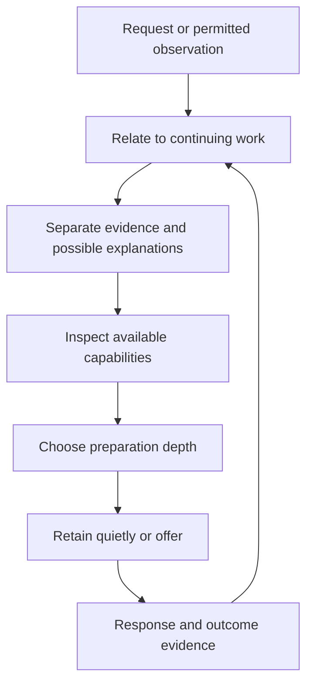

CanvasOS should help people move from a situation that needs attention to a useful next step. Sometimes a person knows the tool they want. Sometimes an existing monitoring agent supplies an observation, and the useful response remains uncertain. Both paths should preserve the intended outcome while choosing how much to prepare.

The direction is to assemble information, tools and authorized controls around work. The flow below is proposed architecture, not a claim that continuing observation or automatic preparation already operates.

## Start with evidence, preserve uncertainty

Suppose a team expects 100 units and has recorded 80. That is an observed discrepancy between two figures. It does not establish an actual shortfall of 20. The figures might concern different periods, incomplete records or different meanings of “recorded.” Those are possible explanations, not facts.

A signal is the supplied observation. An interpretation explains what it might mean for the work. Keeping them separate lets a reviewer correct the explanation without losing the original evidence. Source, time, coverage and known limitations help determine what comparison is justified.

A known but unconnected system remains a possible source. CanvasOS cannot know its contents or silently read it. The next step might require authorized access, a supplied export or a person checking that system. Missing access and missing software call for different remedies.

## Keep the work connected

An **episode** is continuing work toward an outcome, with its relevant history, decisions and unfinished responsibilities. In this example, the episode might be “resolve the difference before the operating review.” It can include several alerts, a conversation and a comparison tool without becoming a new task each time.

A later observation should join relevant existing work when appropriate. Different outcomes may need separate episodes even when their figures look similar. Exact rules for joining or splitting work remain open and depend on the application. A new alert does not automatically require a new canvas.

The loop connects preparation to the episode's outcome. It allows a question, an existing tool or a quiet summary to be useful without generating a new application.

## Choose the smallest useful preparation

Before building, the responsible agent inspects available systems, existing tools and reusable patterns within its permitted scope. A working comparison capability may need only configuration. A missing connection may need access rather than a replacement application. A new tool becomes appropriate when existing capabilities cannot serve the job.

Preparation has several useful forms:

- **Outline:** explain a possible investigation or tool.
- **Specification:** describe intended behavior and constraints.
- **Configuration:** adapt a known pattern or existing capability.
- **Code:** implement behavior that needs construction.

These are choices, not mandatory stages. A clear request with suitable examples may justify code immediately. An uncertain interpretation may justify two short options first. Studio supports refinement when construction is needed; [Build and run](/architecture/build-and-run) explains that path.

Questions should resolve uncertainty that changes the result, audience, authority or substantial effort. In the discrepancy example, whether both figures cover the same period could change the entire comparison. Ordinary layout choices usually belong with the builder. A fixed questionnaire would consume attention without reliably improving the work.

## Prepare quietly, offer deliberately

Preparation and delivery are separate decisions. The platform might retain a comparison outline in the existing workspace until the scheduled review. A material change or explicit request could justify an offer sooner. Business urgency belongs to the application; recipient preferences influence supported delivery. Neither creates permission to disclose information to a new audience.

A prepared design becomes a usable workspace when its views are connected to the intended records and actions, current access is checked, and the team can reach it in a suitable interface. For the delivery review, that means the actual delivery and readable records, not an example that only looks convincing. The [construction journey](/architecture/build-and-run#connect-the-tool-to-the-work) explains this handoff.

Before using retained preparation, reassess its relevance, sources and current authority. A previously usable connection may have changed. A declined offer may indicate timing, redundancy or a mistaken interpretation. It does not close an independently accepted responsibility.

Finally, distinguish generated, offered, opened and helpful. A summary can help without an opened tool; a frequently opened tool can still fail its purpose. Corrections and observed outcomes inform [Knowledge and learning](/architecture/knowledge-and-learning), with uncertainty and unfinished work preserved.
