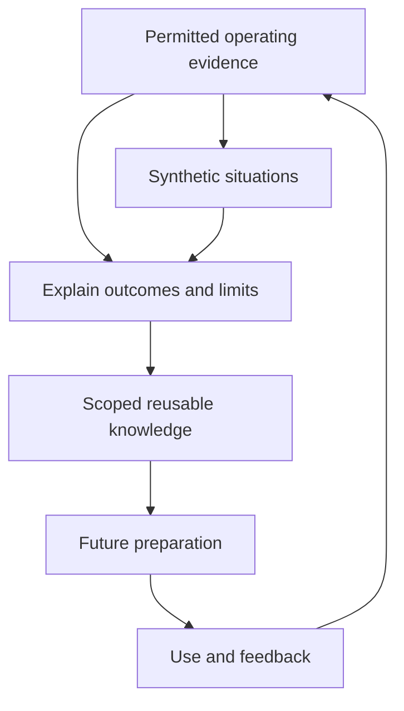

CanvasOS should improve its judgment about what to prepare and how to build it. That requires remembering more than successful screens. Useful knowledge includes what people intended, which information was available, what an agent assumed, what failed and whether the work actually benefited.

The direction is to connect operating experience with reusable construction knowledge. The learning mechanisms below are proposed architecture. They do not claim a working learning system, validated customer model or demonstrated improvement.

## Preserve meaning and context

Application records, episode history, agent memory and reusable patterns serve different purposes. Records describe domain work. An episode connects continuing effort toward an outcome. Agent memory can retain relevant observations or preferences. A reusable pattern helps another construction task under stated conditions.

They should not collapse into a single store with one audience. Customer operating knowledge stays within its permitted installation boundary. Retrieval, summaries and generated answers must respect disclosure limits, just as source documents do. Material available in storage is also different from the context actually supplied to an agent.

Meaning matters alongside values. If one system reports 100 expected units and another reports 80 recorded units, the comparison needs their periods, definitions and coverage. Matching field names do not establish matching meaning. Uncertain interpretation should stay visible so later corrections can explain earlier decisions.

## Learn from outcomes, including non-use

Real evidence can improve both patterns and simulation assumptions. Synthetic situations explore possibilities, but remain distinguishable from observed customer work. Every return around the loop should preserve what its evidence actually supports.

Preparing a tool establishes that construction occurred. Offering it establishes something about delivery. Opening it establishes interaction. None alone establishes benefit. A reviewer might resolve the issue from a short summary without opening anything. Another might repeatedly open a tool because its explanation is confusing.

Useful learning combines corrections, explicit feedback, observed work and relevant outcomes. An outcome after tool use does not automatically prove the tool caused it. A declined tool can expose the wrong timing or an unnecessary feature. Retaining failures and contrary evidence prevents a library from becoming a collection of flattering examples.

## Reuse with a declared scope

Reusable material can include components, configuration, specifications, domain examples, known failures and assessment cases. A pattern should explain where it helped and which dependencies mattered. The comparison layout may transfer easily while its accounting interpretation does not.

Successful customer work can suggest a shared pattern, but sharing requires separate review and permitted scope. Private records, local configuration and operating history do not automatically become another customer's examples or shared model inputs. A useful abstraction can be retained without copying its private source material.

Observed workarounds can suggest missing capabilities or outdated guidance. They are evidence for investigation, not automatic new rules. Earlier rejected ideas can be reconsidered when conditions change while preserving the reason for rejection.

## Use simulation to challenge assumptions

Simulation creates bounded situations for testing construction and response before comparable real experience accumulates. A small fixture can test one calculation or access rule. A synthetic episode can vary source completeness, timing, actor goals or available capabilities. A richer digital twin models selected aspects of a customer environment; a complete organizational twin is not a prerequisite.

The acting agent receives only information it could plausibly observe. If a scenario author knows why the 100 and 80 differ, that explanation must not leak into the agent's context. An unconnected source remains unreadable. The exercise should allow uncertainty, refusal, delay and unsuccessful outcomes where relevant.

Simulated success supports claims within the model's assumptions. It cannot prove a live connector, actual access enforcement or customer benefit. Real observations can reveal that the model's cooperative reviewer or complete records were unrealistic. Preserve the earlier result under its original conditions, then correct the model and reassess affected claims.

## Reassess preparation before reuse

Dormant work can retain an outline, specification, configuration or code without keeping a live runtime. Before reuse, its maintainer should inspect current intent, source meaning, availability, authority and relevant assessment evidence.

A changed source definition may invalidate a comparison while leaving its layout checks useful. Missing current access can block a live variant while a synthetic rehearsal remains available. Reassessment should identify affected claims rather than mark everything permanently valid or discard everything together.

Retiring a preview need not erase its useful findings or unresolved responsibility. [Discover and prepare](/architecture/discover-and-prepare) uses this retained knowledge to choose the next appropriate intervention.
