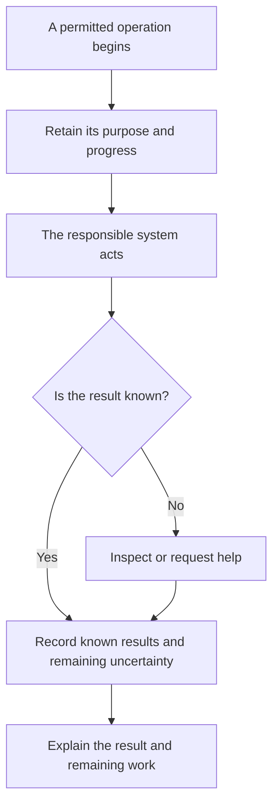

A useful workspace needs support after it appears. Its sources can change, a connection can fail, an update can break a calculation, or the person responsible for the work can leave. CanvasOS needs to make those changes understandable and give someone a supported next step.

The operating design connects four questions: what happened, who can act, what the work consumes, and what should improve next. These responsibilities apply to native applications and to the platform that hosts and manages them.

## Explain what actually happened

Consider a team using a delivery-comparison workspace. The workspace shows that a request to retrieve another record was sent, but no result arrived. A useful status would explain which information remains available, which request is uncertain and who can inspect it.

The request may have failed before reaching the source. The source may have completed it while the response was lost. A timeout alone cannot settle that question. The responsible connection needs a supported way to inspect the result or explain that it remains unknown.

The diagram separates sending work from knowing its outcome. The responsible system performs the action; CanvasOS should retain enough context to help people understand and continue it.

Diagnostic logs help engineers investigate. The team using the workspace needs a shorter explanation of the result, its limits and available next steps. Both should refer to the same operation without requiring the team to read infrastructure logs.

## Make access understandable

The platform must distinguish permission to view information, operate a tool, change its code and manage the installation. Someone who can discuss a delivery discrepancy does not automatically gain the right to deploy an application or inspect management credentials.

Customer-controlled sharing can make a workspace useful to people who do not each have a separate account in every source system. That sharing still needs an intended audience. Adding an external participant or sending a diagnostic screenshot can change who receives the information.

Support follows the same principle. Central coordination of installations does not create unrestricted access to customer content. An investigation should use the information permitted for that purpose and make any missing access visible.

## Control cost without losing the work

Preparing tools consumes model calls, retrieval, storage and maintenance. Offering them also consumes human attention. Generating more candidates is useful only when they improve the work enough to justify those costs.

CanvasOS should make relevant consumption and limits inspectable. The reviewed direction favors warnings near soft budgets, reasonable room to finish work, and approval for significant additional work. Exact thresholds and charging arrangements remain design choices.

Payment, resource availability and permission to act answer different questions. A company paying for a workspace does not thereby gain access to every record inside it. A permitted action can still lack the resources needed to finish.

Dormant candidates can preserve useful preparation without keeping every runtime active. Retiring an unused interface should preserve any decisions or unfinished responsibilities that still matter to the team.

## Keep explanations current

Documentation is part of operating CanvasOS. People and agents should be able to find what a capability is intended to do, what is currently supported and which limitations apply.

Mintlify is the selected documentation platform. CanvasOS remains responsible for the accuracy and readability of its content. Review should follow changes in behavior, relevant examples and observed operating results. A built documentation page does not prove the product behavior it describes.

Later assistance may connect a documentation question to permitted information about a particular installation. That would let a reader understand why a documented capability is unavailable in their environment. The actual integration and disclosure boundaries still need engineering and validation.

## Questions still to resolve

Retention periods, diagnostic tools, support access, resource accounting and commercial terms are open. They should be chosen around real operating needs. Their design should help a person answer: what can I trust here, what remains unfinished, and what can I do next?

Continue to [delivery and open choices](/architecture/delivery-and-choices).
