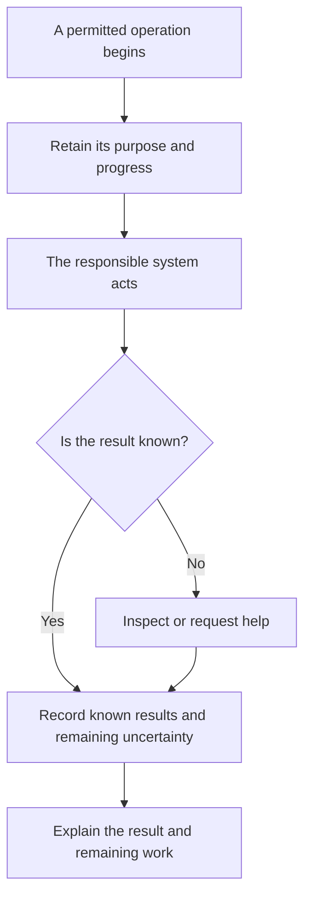

A useful workspace needs support after it appears. Its sources can change, a connection can fail, an update can break a calculation, or the person responsible for the work can leave. CanvasOS needs to make those changes understandable and give someone a supported next step.

The operating design connects four questions: what happened, who can act, what the work consumes, and what should improve next. These responsibilities apply to native applications and to the platform that hosts and manages them.

## Explain what actually happened

Consider a team using a delivery-comparison workspace. The workspace shows that a request to retrieve another record was sent, but no result arrived. A useful status would explain which information remains available, which request is uncertain and who can inspect it.

The request may have failed before reaching the source. The source may have completed it while the response was lost. A timeout alone cannot settle that question. The responsible connection needs a supported way to inspect the result or explain that it remains unknown.

The diagram separates sending work from knowing its outcome. The responsible system performs the action; CanvasOS should retain enough context to help people understand and continue it.

The responsible owner needs durable records of work accepted under the applicable permission checks, including unfinished responsibility. Searchable summaries and sampled telemetry can help inspection, but their freshness and gaps must remain visible. They cannot become another source of authority. The proposed core design keeps required change evidence with the change; unavailable optional analytics should not make a committed change appear rejected. If required durable evidence cannot be committed, the proposed core path stops the dependent mutation.

Diagnostic logs help engineers investigate. The team using the workspace needs a shorter explanation of the result, its limits and available next steps. Both should refer to the same operation without requiring the team to read infrastructure logs.

## Make access understandable

The platform must distinguish permission to view information, operate a tool, change its code and manage the installation. Someone who can discuss a delivery discrepancy does not automatically gain the right to deploy an application or inspect management credentials.

Customer-controlled sharing can make a workspace useful to people who do not each have a separate account in every source system. That sharing still needs an intended audience. Adding an external participant or sending a diagnostic screenshot can change who receives the information.

A retained comparison also has a disclosure lifetime. If the customer permits retained use, a connector outage can block refresh while the summary remains readable to its current audience. Removing a reviewer or withdrawing that disclosure changes subsequent reads, including cached results and derived answers. Source failure and withdrawal are different conditions; the application must express the conditions it supports.

Export can disclose the same information to another destination. Reading a workspace does not authorize every export. Delayed publication and export need the supported current-authority checks. Removing access later cannot promise recall of copies already received. Diagnostic capture and export likewise need a permitted scope and audience. Customer data policies also constrain what may reach models, exports and support tools; the design must make clear which paths it can inspect and enforce.

Support follows the same principle. Central coordination of installations does not create unrestricted access to customer content. An investigation should use the information permitted for that purpose and make any missing access visible.

## Control cost without losing the work

Preparing tools consumes model calls, retrieval, storage and maintenance. Offering them also consumes human attention. Generating more candidates is useful only when they improve the work enough to justify those costs.

CanvasOS should make relevant consumption and limits inspectable. The reviewed direction favors warnings near soft budgets, reasonable room to finish work, and approval for significant additional work. Exact thresholds and charging arrangements remain design choices.

Payment, resource availability and permission to act answer different questions. A company paying for a workspace does not thereby gain access to every record inside it. A permitted action can still lack the resources needed to finish.

Commercial availability also differs from readiness: a customer can have a paid right to a capability while its connection or setup is unusable. Observed consumption, provider expense, allocated cost and customer charges need distinguishable explanations. A lost response can leave cost uncertain as well as the external effect. Exact accounting and charging mechanisms remain open.

Technical capacity needs separate treatment from money. The supported workload must leave a way to finish, inspect and clean up accepted work when new intake is constrained. Older unfinished operations should remain discoverable after restart and continuing arrivals. Stopping optional new spending still leaves accepted work and recovery needing a supported next step. No capacity amount or operation through a total storage outage is promised.

Dormant candidates can preserve useful preparation without keeping every runtime active. Retiring an unused interface should preserve any decisions or unfinished responsibilities that still matter to the team.

## Maintain installations and attention

Fleet coordination should distinguish offered releases, customer-authorized updates and observed installed versions. Customer configuration and deliberate customization can affect compatibility. An update needs to account for that variation and unfinished work; a shared release should not silently erase them. [Recovery and platform changes](/architecture/recovery-and-platform-changes) explains the more powerful path for updating the management executor itself.

An organizational dashboard should bring together status, alerts and unfinished work across workspaces. Related failures should lead to understandable next work rather than one interruption per generated interface. Applications own business urgency; the platform supplies supported grouping, routing and delivery. Quiet delivery should still let an operator distinguish waiting for a person, intentional pause, expected sleep and unavailable observation. A progress indicator or high tool count cannot establish useful work.

## Keep explanations current

Documentation is part of operating CanvasOS. People and agents should be able to find what a capability is intended to do, what is currently supported and which limitations apply.

Mintlify is the selected documentation platform. CanvasOS remains responsible for the accuracy and readability of its content. Review should follow changes in behavior, relevant examples and observed operating results. A built documentation page does not prove the product behavior it describes.

The proposed maintenance flow follows a changed capability through its code, decisions and operating evidence into an updated documentation candidate. The first-party maintainer checks content, links and applicable examples, captures and inspects relevant actual interface screenshots, then uses the supported publication process. Published content and agent retrieval need their own inspection. A preview screenshot establishes appearance; it cannot prove an underlying product capability. Editing, assessment and publication remain separate permissions.

Phase one should demonstrate that internal readers, external readers and agents can find the intended version and status, with allowed and refused retrieval under the selected audience controls. Machine access must respect the same intended boundaries as the visible site. It should also demonstrate an attributable maintenance run. This delivery can precede optional integration with CanvasOS reader identities and the mesh.

In phase two, the documentation system representative can request permitted installation facts through the responsible agents. For example, a reader asking why a feature is unavailable may need its actual installed version and usable connections. The answer should separate documentation guidance, observed installation facts and what remains unknown. An unavailable observation path must remain visible. Reading documentation grants no customer-data or management access; the exact integration still needs engineering and qualification.

## Questions still to resolve

Retention periods, diagnostic tools, support access, resource accounting and commercial terms are open. They should be chosen around real operating needs. Their design should help a person answer: what can I trust here, what remains unfinished, and what can I do next?

Continue to [delivery and open choices](/architecture/delivery-and-choices).
