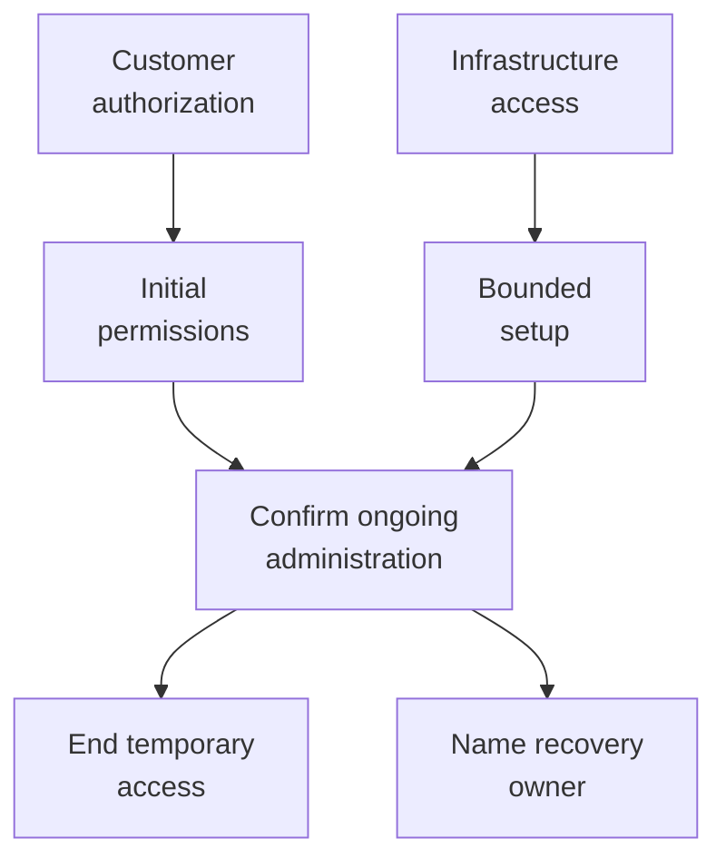

Setting up or repairing an installation can require power that ordinary application work does not. CanvasOS needs to explain where that power comes from, what it can change and how it ends. Otherwise, a convenient setup or update path could defeat the customer-side authority it establishes.

Customer-side access authority and the default location of long-lived management credentials are agreed direction. The setup, update and recovery flows below are proposals. They still need implementation and operating evidence.

## Establish initial authority deliberately

Before the installation has its first administrator, it cannot use an existing membership to authorize that administrator. Initial authority therefore needs a verified customer setup mandate identifying the intended organization, installation and nominated administrator. First login, a matching email or possession of working Cloudflare access cannot supply that mandate automatically.

Two permissions are involved: authority to establish the CanvasOS organization relationship and infrastructure permission for the declared setup operations. One person may hold both. The proposed first investigation uses operator-assisted setup under an independently verified customer instruction; its verification process still needs implementation and qualification.

Setup binds the verified nominee to the accepted instruction, records partial progress and establishes the ongoing human and service identities. Successful authentication, initialized membership, deployed resources and completed handoff are separate facts. If authority initializes but deployment fails, continuing setup must not reset permissions or replace an administrator whose rights have since changed.

The diagram shows two sources of permission joining at handoff. Performing setup does not itself grant ongoing administration. Temporary access needs a declared end or separately authorized continuation. A repeated request should continue the accepted setup rather than create another organization or reset existing access.

Recovery also needs an identified customer-authorized path that remains usable through the particular failure it claims to handle. If the only recovery credential resolves through a failed executor, that path cannot recover the executor. Its design must expose that dependency rather than assume a central bypass.

## Check both the target and what changed code can reach

A management change has three scopes: the caller's permitted action, the provider deployment target, and the resources reachable by the resulting code. Qualifying one does not establish the others. A credential limited to updating one runtime may still let replacement code use powerful resource bindings: connections that let running code access other resources.

The design therefore needs actual account, environment and resource relationships, including deliberately shared resources. Names and environment labels help inspection; they cannot prove separation. A missing test-environment resource connection must not silently select operating data or trigger a retry with broader access. Exact provider restrictions and adapter enforcement still need evidence.

Information entering through a document, external system or model result can also contain misleading instructions. Its content should not change trusted execution rules or grant authority. Prompt guidance can help an agent reason, while the responsible resource boundary still needs to enforce the permitted effect. [Build and run](/architecture/build-and-run) covers assessment of application code and its capabilities.

## Authorize changes to privileged code separately

The management executor uses protected credentials and enforces the restrictions on requests. Permission to update an ordinary application target does not therefore authorize replacing that executor.

The proposed update path authorizes a specific transition from the observed current executor to an assessed replacement. Its review considers code and configuration, changed bindings and reachable data, credential use, permission checks, state compatibility and unfinished operations. If the current executor changes before dispatch, the earlier approval cannot silently authorize replacing whichever version is now present.

A customer-authorized policy can approve routine compatible releases automatically. A release offer alone is insufficient, and a scope-expanding release cannot inherit routine-update authority. The replacement's own success report cannot establish its right to operate.

The design must identify the effective trusted owner: who can change the updater, the code that approves changes, and its rules? If one replaceable process can rewrite its approver and install arbitrary successors, checks within that process do not independently constrain it. A separately controlled approval process or updater is one possible mechanism; none is selected. Any continuing central route to arbitrary credential-using code must remain visible as a route to that credential's power.

During an unresolved transition, the proposed design pauses new changes dependent on that executor while supported independent inspection continues. Existing operations still need a decision about their remaining work. Inspection should compare the running version and relevant permission checks with the approved transition; a startup check establishes less. Suspected credential exposure may require separately authorized replacement and trusted recovery, even after code rollback.

## Distinguish the recovery being claimed

| Recovery | Useful result | Remaining limit |
| --- | --- | --- |
| Interrupted-operation recovery | Inspect or continue known unfinished work | A missing acknowledgement does not establish that no effect occurred |
| Compatible code rollback | Return to a supported serving implementation | Persistent data, grants, resources and external effects do not automatically return with it |
| Rebuild an inspection view | Reconstruct a permitted view from its owner | Missing history cannot be invented, and the view cannot create authority |
| Authoritative-state restoration | Recover an owner's records | Recovered permissions and pending operations may no longer describe the current world |

The proposed first installation investigates interrupted management work and compatible rollback of the declared target, with rebuilding of derived views where used. Complete installation reconstruction, provider-outage serving and universal data rollback are separate unsupported claims until explicitly designed and qualified.

## Reopen restored authority under current permission

Suppose a snapshot contains a member removed after the snapshot and an operation later sent to the provider. Restoring it can revive the old grant and make a completed effect appear pending. Reopening immediately or replaying its queue could cause unauthorized or duplicate work.

The recovery design needs a customer-authorized trust basis outside the affected rollback scope. An old grant cannot authorize its own restoration. Infrastructure access, a backup location or a decryption key establishes a different capability from organization recovery authority.

Before reopening, the supported path must account for subsequent revocations, narrowed scope, disclosure restrictions and replaced credentials. Surviving current authority or sufficiently complete change evidence may supply that basis. Where history is incomplete, a separately authorized fresh limited grant set is a proposed alternative; it does not establish that all former access was recovered. Without a supported current basis, the affected path remains unavailable.

Recovery also needs compatible code and record formats, usable inputs and an authorized actor. Independence depends on the failure: materials outside one database can survive its rewind while still depending on the same unavailable provider. Neither a backup receipt nor an accessible inventory proves that the complete recovery path works.

Known unfinished effects require permitted provider inspection before repetition. Lost later records can leave unknown work even when the snapshot looks clean. The result should state which scope reopened, what remains uncertain and who owns the remaining recovery. It should not imply that code restoration reversed disclosure or recalled external copies.

Return to [Core and boundaries](/architecture/core-and-boundaries) for ordinary authority, or [Operating and evolving](/architecture/operating-and-evolving) for continuing inspection and support.
