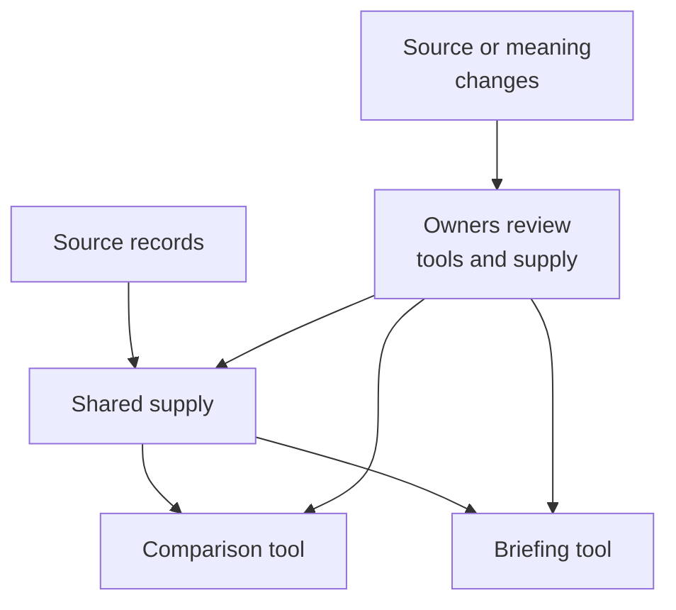

Several applications may need the same operational records. Several agents may use the same review instructions. Reuse should reduce repeated work while keeping clear who owns the meaning, who maintains the supply and what each consumer actually uses.

This operating model is proposed architecture. Storage, formats and integration mechanisms remain open. Customer information and operating history remain subject to the customer's access and sharing rules.

## Supply information independently of its views

A reusable supplier offers supported information or operations to consuming applications. It could be a governed query through an existing source, or an application-owned service that maintains a selected dataset or calculation. A comparison tool and a briefing tool could use the same supplier while retaining different purposes, views and audiences.

The source owner remains responsible for its records. A supplier's meaning owner explains selections, relationships, units and calculations. Its refresh owner maintains continuing production. Consumer owners decide whether the output fits their applications. These responsibilities can share a team or service; a view author should not accidentally inherit an unattended extraction job.

The diagram shows one supply relationship serving several consumers. Source changes return through responsible owners, rather than silently changing every application's assumptions. Each read and disclosure still needs its applicable authority.

A selection definition differs from each output it produces. The same query can return new records tomorrow. A failed refresh must not publish an empty or partial output as a successful complete result. The supported response could retain an older permitted result with its age and coverage, expose a declared partial result, or withhold dependent output.

A changed amount can retain its field name while moving from before credits to after credits. Consumers may then need adaptation even though their code still builds. Owners should identify known affected bindings, assess compatibility and retain unresolved consumer coverage. A pinned definition cannot preserve revoked access or a vanished source. Removing one view does not automatically retire supply used elsewhere.

## Distinguish intent, references and generated guidance

An inspiring document differs from an adopted organizational rule. Authorized owners adopt governing intent. Engineering owners maintain the generation process that turns that intent into instructions, templates, tool descriptions or evaluation checks. Generated guidance can support independently operated customer agents without replacing their internal systems.

Keep adopted intent, revisions to that generation process, generated outputs and published releases distinguishable. Repairing the generation process can change its output while intent stays fixed. Feedback may instead justify an authorized intent revision or a scoped exception. If a checker applies the wrong criterion, repair its assessment basis; a favorable score must not come from silently weakening the intended job or platform boundary.

Distribution and effective use are separate. A published instruction may not reach a disconnected consumer. An installed file may change while an active conversation retains earlier context. Tool descriptions or exposed operations may change under a familiar name. Inspect the consumer state that the integration can actually reveal, preserve supported work that deliberately uses an earlier version and assign unresolved adoption to an owner. Do not invent access to an external agent's private process.

Assessment should examine representative combinations of guidance, tools and context. Individually assessed assets do not prove the combination behaves appropriately. Approved instructions also cannot grant data access, export rights or authority to change an application.

## Correct or withdraw material through its owners

Content changes have different effects. A correction replaces or qualifies an inaccurate account. Withdrawal stops supported publication or use. An audience change alters permitted access. Removal deletes identified material within controlled scope. Retirement ends a view or operating relationship without necessarily deleting its source records.

For example, correcting a review summary's reporting period can require rebuilding a controlled index and derived briefing. The current account should explain the correction while retaining permitted evidence of what earlier decisions used. The supply, generation and preparation owners assess affected outputs and claims; independent layout checks may remain useful.

An authorized withdrawal must not be bypassed through a retained cache or generated answer. Owners should inspect known controlled copies, summaries, prepared snapshots and generated context, then report actual changes and unresolved coverage. A list of known copies does not establish complete discovery. Exports already downloaded and external agents' loaded context may lie outside supported recall.

Restoring an older snapshot must respect later restrictions before reopening affected material. An old backup cannot establish that no subsequent withdrawal occurred. If current restrictions cannot be established, the affected restored path lacks a supported basis for reopening. Unrelated supported work can continue.

Keep permitted evidence of the decision, responsible actor, actual result and remaining limits. That evidence must not retain the content ordered removed merely for audit convenience. Removal also does not reverse earlier external effects or complete unfinished responsibilities. Exact retention, propagation and recovery mechanisms remain design choices.

Return to [knowledge and learning](/architecture/knowledge-and-learning) for how these relationships inform preparation, or [build and run](/architecture/build-and-run) for application changes and assessment.
