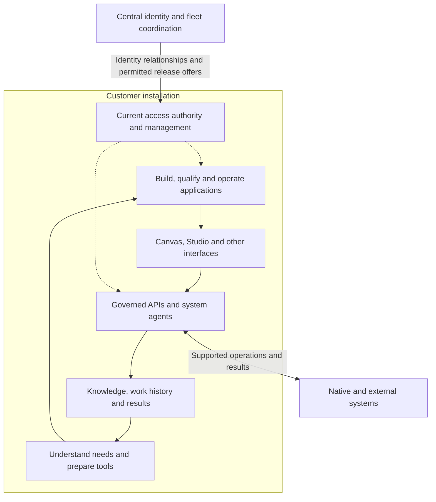

CanvasOS is intended to help an organization recognize work that needs attention, prepare useful tools, and improve those tools through use. A person can ask for an application. A familiar situation can suggest an existing pattern. With suitable access, observations can also prompt preparation before someone asks.

This page maps the proposed architecture behind that experience. The canvas is the expected primary place where people compose and use tools. The platform also supports Studio, focused web routes and capabilities used by agents without a visible interface.

## The main responsibilities

The architecture connects three broad areas: central coordination, a customer's operating installation, and the systems the customer uses. An installation is an identifiable deployment with its own operating boundary. These areas describe responsibilities; each box does not require a separate service.

The loop shows how operating results can improve future preparation. The authority links show where permission constrains work. Connections to external systems depend on actual access and supported operations.

Central services establish identity and installation relationships, maintain permitted fleet information, and distribute releases. Customer-side authority owns current organization membership and access rules. The customer's installation also holds long-lived Cloudflare management credentials and the trusted executor that uses them. Central coordination sends permitted requests without keeping equivalent standing access.

## From a need to a working tool

Understanding the work draws on organizational knowledge, available systems, prior episodes and the person's intent. An episode is the continuing history of work toward an outcome. It can span conversations, interfaces and interruptions.

Preparation can produce a description, configuration, specification or code candidate. The useful output depends on how well the need is understood. An uncertain situation may call for options before construction. A clear brief may justify building immediately.

The application lifecycle turns a candidate into a qualified release and applies it to an intended installation. Interfaces then expose its useful information and actions. An application can own domain behavior and data while using common platform identity, access and lifecycle facilities. [Build and run](/architecture/build-and-run) explains that relationship.

System-specific agents coordinate capabilities through the mesh: the means by which system representatives work together. Interfaces can also call governed application APIs directly. Both paths need applicable authority; a known save action does not require new model reasoning each time.

Preparation can also connect ongoing work across systems. A delivery issue may affect inventory, a customer promise and an invoice review. CanvasOS can prepare a shared review or handoff while each system keeps its own responsibilities. The aim is useful coordination across those activities, not just a separate generated screen for each one.

## Example: preparing a delivery review

A team needs to understand why one source shows 100 units expected and another records 80 received. CanvasOS can reuse a comparison pattern and prepare an interface that brings those records together. Each source keeps ownership of its records; the workspace helps the team inspect the difference and choose a next step.

If another ledger is known but unconnected, its contents remain unknown. The comparison should show that missing evidence rather than declare an actual shortage or invent a reconciliation.

The team might request access, supply another record or decide that the comparison is unnecessary. Those responses help improve future preparation. Opening a workspace alone cannot establish that it solved the problem.

## What comes first

The intended delivery order is core, mesh, a non-canvas operating proof, then interface runtimes. This establishes identity, authority and real operations before relying on a polished canvas experience. Preparation and learning remain part of the architecture throughout.

Important choices remain: application hosting and isolation, capability descriptions, shared domain meaning, and the breadth of common backend services. Continue with [discover and prepare](/architecture/discover-and-prepare) to follow how a need becomes a workspace.
