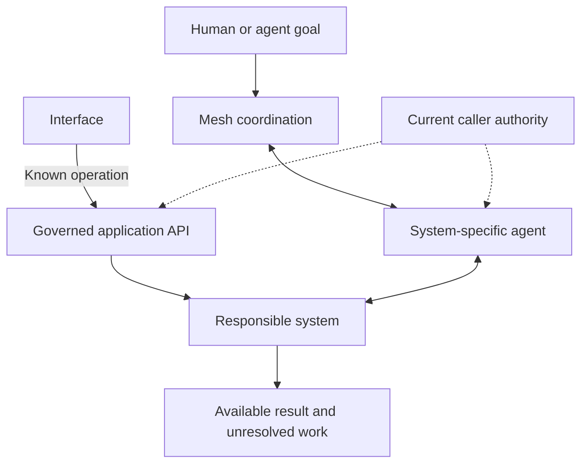

CanvasOS should bring an organization's existing capabilities into useful workspaces and construct missing capabilities when justified. Customers should be able to keep their CRM, workflows and independently operated agents while gaining better ways to use them together.

A system can be a native application, external platform, workflow or customer agent. A system-specific agent represents that system in the mesh, the coordination layer through which representatives work together. The underlying system retains its domain behavior and execution responsibilities.

## Knowing a system is different from using it

The platform needs to distinguish four facts about a system:

- Known: the organization has identified it.
- Connected: an access relationship exists.
- Described: supported behavior and prerequisites are understood.
- Usable now: this work has the necessary access, data and configuration.

These distinctions shape preparation. A known CRM may be worth connecting instead of rebuilding. A working connection may still lack permission to update a particular record. A capability description explains useful behavior; current conditions determine whether it is available for the present work.

The inventory should preserve where information came from and when it was observed. A temporary connection failure should not erase knowledge that the customer owns the system. Conversely, an old successful connection should not make an unavailable action appear ready.

## Two paths to the same capability

The direct path suits a known action, such as saving a selected record. The mesh path suits interpretation or coordination across systems. The representative is the mesh participant; an individual capability is something it exposes. Both paths depend on the caller's applicable authority.

A representative explains its system's capabilities, interprets requests, identifies missing context, arranges supported operations and reports available evidence. It may use reasoning when interpretation is necessary. A deterministic operation need not invoke a model merely because an agent originally assembled the interface.

One logical representative can expose several capabilities. The architecture does not require a separate agent for every widget, record or operation. Deployment and identity boundaries should follow the system's useful operating scope.

## Example: reviewing a customer renewal

A person asks why a renewal is at risk. The CRM representative can retrieve permitted relationship information. A document-system representative can find relevant review notes. A coordinating agent can interpret those results and prepare a focused review view.

Once the person chooses a known action, such as saving a review status, the interface can call a governed API directly. The CRM still owns the record and its update rules. If the user can read the shared review but cannot change the CRM record, presenting the action cannot create that permission.

If the document connection is unavailable, the episode should retain that gap. The system can explain the missing evidence and continue independent work. Connecting the document store, changing access or building a replacement each requires its own appropriate authority and follow-through.

## Coordination does not replace execution

An agent message does not provide persistent workflow state, safe retries or crash recovery by itself. Work that must survive interruption needs those mechanisms in the responsible system or in a deliberately selected execution mechanism. External workflows and customer agents retain that responsibility when CanvasOS coordinates with them.

Results should explain what was requested, attempted and observed. A timeout can leave an external effect uncertain. The supported integration must determine whether inspection, repetition or human help is appropriate. Similarly, cancellation and pause depend on what the target system can actually enforce.

A customer agent may expose requests and result reports without exposing its private reasoning or full lifecycle. That partial integration can still be useful when its limits are clear.

## Shared meaning and open choices

Systems may mean different things by “active customer” or “completed review.” Useful mappings should preserve the source and intended meaning. Stable relationships should be recorded beyond a single prompt.

The architecture leaves capability descriptions, discovery, request formats and transport open. It also leaves the balance between shared domain models, local mappings and agent interpretation open. These choices should be tested against representative work, while [core authority](/architecture/core-and-boundaries) supplies a consistent permission boundary for both operating paths.
