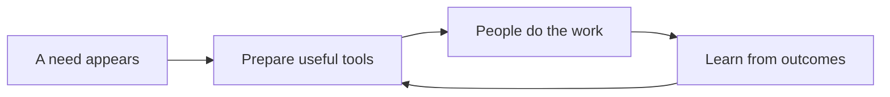

CanvasOS is intended to help people turn a situation that needs attention into a useful place to work. Agents bring together information, existing tools and purpose-built interfaces so a team can understand what is happening and decide what to do.

Sometimes a person asks for a tool. Sometimes permitted observations suggest that a comparison, investigation or shared review would help. CanvasOS should become better at recognizing those needs, preparing the right support and learning from what people actually find useful.

The canvas is an important way to present that work. The broader platform provides the access, connected systems, application-building capabilities and continuing context behind it. A focused web page, an agent or a direct software connection can use those same capabilities.

This guide describes the intended architecture for review. Some boundaries are agreed; many engineering choices and the operating platform remain to be built and demonstrated. The last chapter brings those choices together.

A **workspace** brings together information, application views and controls around a piece of work. Applications supply behavior; a host such as Canvas or a focused web page presents it. The work can continue across several workspaces or conversations.

## Follow one situation through the platform

Imagine a team preparing for a delivery review. One source says 100 units were expected. Another records 80 received. The difference may deserve investigation, but the available records do not yet prove that 20 units are missing.

CanvasOS could prepare a workspace that puts the records side by side, shows where they came from and gives the team useful next actions. The team might find another record, request access, explain a mismatch or decide that the workspace is unnecessary. The platform should preserve what was learned, rather than count creating a screen as success.

The loop describes the product's purpose. The following chapters explain the systems needed to make it work.

## A reading path

For a first conversation, read the system map, discovery and preparation, and build and run. Together they follow the journey from a need to a usable tool. The remaining chapters explain the supporting systems and delivery choices.

1. [See the whole platform](/architecture/system-map): understand the major responsibilities and their relationships.
2. [Follow discovery and preparation](/architecture/discover-and-prepare): see how an observation can lead to a workspace.
3. [Follow a tool from idea to use](/architecture/build-and-run): connect generation, data, actions and the different interfaces.
4. [Connect systems and agents](/architecture/systems-and-agents): understand how existing systems participate.
5. [Understand knowledge and learning](/architecture/knowledge-and-learning): see how context, examples and outcomes improve future work.
6. [Understand the operating foundation](/architecture/core-and-boundaries): locate identity, access, installations and management responsibilities.
7. [Operate and improve the platform](/architecture/operating-and-evolving): connect reliability, support, resources and documentation.
8. [Review delivery and open choices](/architecture/delivery-and-choices): separate agreed direction from remaining design and implementation work.

Each chapter explains its subject independently. Read in sequence for a connected walkthrough, or return directly to a topic when discussing a particular decision.
